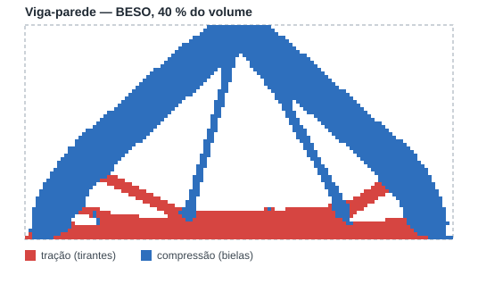
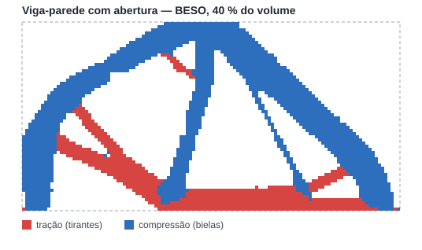

<div align="center">

# STM-TopOpt

**Otimização topológica e análise não linear de regiões D de concreto armado — direto no navegador**


<table>
  <tr>
    <td align="center"></td>
    <td align="center"></td>
  </tr>
</table>

<sub>Topologias geradas pelo próprio programa (BESO, 40 % do volume). Vermelho: região tracionada (tirantes). Azul: região comprimida (bielas).</sub>

</div>

> ⚠️ **Protótipo para estudo.** Os resultados estão sendo calibrados contra a literatura (veja [Validação](#-validação)) e **não substituem** o projeto de um engenheiro responsável. A extração automática de bielas e tirantes **não** faz parte desta versão.

---

## ✨ O que faz

| | |
|---|---|
| 🧱 **Geometria livre** | Desenhe a região D (retângulos e polígonos, várias aberturas), posicione forças e apoios **sobre os lados** e escolha o tipo de apoio (fixo ou móvel). |
| 🧮 **MEF em estado plano** | Quadrilátero Q4 com **modos incompatíveis (QM6)**, solver direto em banda, reações de apoio com resíduo de equilíbrio. |
| 🕸️ **Otimização topológica** | **BESO** (padrão) ou **SIMP**, com filtro, proteção de conectividade entre cargas e apoios e histórico iteração a iteração. |
| 🌊 **Campo de tensões** | Trajetórias de tração e compressão, mapas σ1/σ2, deformada. |
| 🔩 **CSFM linear** | Zonas tracionadas e armadura sugerida `As = T/fyd` a partir do campo elástico, sem otimização. |
| 📐 **Largura de biela** | Largura mínima pela NBR 6118 (Borges, 2022) para sugerir o raio do filtro. |
| 🧪 **Análise não linear (Nível 2)** | Concreto sem tração + barras de aço com **aderência perfeita**, fissuras girantes, controle de carga com bissecção até o esmagamento ou a ruptura da barra. Base do futuro CSFM completo. |

## 🚀 Início rápido

Precisa do [Node.js](https://nodejs.org) 20 ou superior (uma vez, só para instalar e servir a página). O cálculo roda **inteiramente no navegador**, num Web Worker: nenhum dado sai do seu computador.

```powershell
git clone https://github.com/caio-io/otimizacao-topologica.git
cd otimizacao-topologica
git checkout csfm          # ramo com as funcionalidades mais recentes
npm install
npm run dev                # abra o endereço mostrado (normalmente http://localhost:5173)
```

```powershell
npm test                   # testes do núcleo (≈ 90 s)
npm run build              # arquivos estáticos em apps/web/dist
```

> Não funciona abrindo o `index.html` direto do disco; use `npm run dev` ou hospede `apps/web/dist` em qualquer servidor web.

## 🌿 Ramos do repositório

| Ramo | Conteúdo |
|---|---|
| `main` / `dev` | Versão estável (hoje os dois apontam para o mesmo commit): editor de geometria, BESO/SIMP, reações, cargas distribuídas, largura de biela, CSFM linear e BESO com proteção de conectividade. |
| **`csfm`** | Tudo de `main` + elemento **QM6**, índices de avaliação (**TRS/SR**), **análise não linear (Nível 2)**, calibrações e roteiro do CSFM. **Comece por aqui.** |

## 🧪 Validação

Cada etapa é conferida contra a literatura. Os números completos, com limites e ressalvas, estão em [`docs/csfm-roteiro.md`](docs/csfm-roteiro.md).

| Verificação | Referência | Resultado |
|---|---|---|
| Elemento QM6 (viga esbelta, 2 elementos na altura) | Timoshenko | flecha/analítica **0,996** (Q4 puro: 0,889) |
| Compressão uniaxial, C30 (Nível 2) | `fc·A` = 1092,9 kN | **1092,3 kN** |
| Tirante de 10 cm² (Nível 2) | `As·ft` = 469,6 kN | **469,3 kN** |
| Barra embutida inclinada a 60° (Nível 2) | teoria elástica | erro **3,4 %** |
| Viga-parede com tirante (Nível 2) | equilíbrio de seção | braço de alavanca implícito 1,35 m ≤ 1,4 m ✔ |
| Viga-parede com abertura, índice **TRS** — Xia et al. (2020) | 61–83 % (publicado) | **82–84 %** |
| Nove posições de abertura — Queiroz & Leonel (2025) | ordem 6 > 2 > 3 > 1 | **mesma ordem** com filtro de 3–4 elementos; magnitude 40–85 % do publicado |
| Cabeça de pilar S1 — livro do CSFM (cap. 6.5) | ensaio 556 kN/apoio | **550–608 kN** (malha de 20–40 mm, εcu = 3,5 ‰, comprimento de esmagamento 0,26 m); CSFM do livro 610–629 kN; cai ≈ 10 % ao refinar |

<details>
<summary><b>O que a validação ainda não cobre</b></summary>

- O índice **SR** de Xia et al. não foi reproduzido (≈ 4× menor que o publicado).
- O consolo e o dente Gerber do mesmo artigo ainda não foram calibrados.
- O Nível 2 não tem **amolecimento por tração transversal (kc2)** nem **tension stiffening**; a fórmula de kc2 não consta nas fontes disponíveis e está pendente.
- O critério de esmagamento do concreto depende da malha quando verificado ponto a ponto; o livro usa a deformação média sobre um comprimento de esmagamento (opção `crushLength` do solver).
</details>

## 📖 Mini manual do editor

<details>
<summary><b>Passo a passo</b></summary>

1. **Escolha um exemplo** em *Exemplo*: *Viga-parede* (3,0 × 1,5 m, 1000 kN no topo) ou *Viga-parede com abertura*.
2. **(Opcional) Pré-análise:** **Campo elástico (sem otimizar)** mostra as trajetórias de tensão do domínio cheio.
3. **Otimize:** **Otimizar** remove material pouco solicitado até a *fração de volume*. **Parar** interrompe; *Iteração (histórico)* volta a qualquer passo.
4. **Visualização:** *Topologia + trajetórias*, *Deformada (MEF)*, *Mapa σ1* ou *Mapa σ2*; dá para mostrar a malha.
5. **Reações de apoio** aparecem na tela e na barra lateral, com o resíduo de equilíbrio (deve ser ≈ 0).
</details>

<details>
<summary><b>Editando geometria, apoios e forças</b></summary>

| Ação | Como |
|---|---|
| Material | **Retângulo** / **Polígono** (arraste, ou clique vértices; duplo clique/Enter fecha) |
| Abertura | **Abertura** / **Abertura poligonal**; pode haver várias |
| Força pontual | Clique num **lado**; força concentrada em **um nó** (gera pico de tensão local) |
| Carga distribuída | Clique num lado (placa da largura configurada) ou arraste ao longo dele. Digite a **resultante** (kN); a intensidade em kN/m aparece na tela |
| Apoio | Arraste ao longo de um lado (ou clique para apoio pontual). Tipos: *fixo*, *móvel desliza em x* (só uy), *móvel desliza em y* (só ux) |
| Mover / excluir | **Selecionar/mover**: arraste. **Delete** exclui o item selecionado |
| Navegar | Roda: zoom · botão direito: deslocar · **Ajustar vista** |
| Travar | **Travar geometria principal** impede mover o material; aberturas, forças e apoios continuam livres |
| Limpar | **Limpar resultados** ou **Limpar tudo** |

**Regras:** forças e apoios só ficam sobre os **lados** da geometria; a largura da placa de aplicação é única; são necessários ao menos 3 vínculos que impeçam o corpo rígido, uma força e um apoio em cada direção da resultante — o programa avisa o que falta.
</details>

<details>
<summary><b>Parâmetros</b> (passe o mouse sobre cada um na interface para ver a dica)</summary>

- **Método** — BESO (padrão): resultado preto-e-branco, parecido com uma treliça. SIMP: densidades contínuas.
- **Fração de volume** — quanto do material original deve restar (0,35 = 35 %).
- **Raio do filtro** — distância, em elementos, em que vizinhos se influenciam; define a espessura mínima das barras.
- **Tamanho do elemento** — resolução da malha (limite de 20 000 elementos).
- **fck / espessura** — *Ajustar filtro pela largura da biela* usa `a = F/(t·σRd,max)` de Borges (2022).
</details>

## 🗂️ Estrutura

```
packages/core        @stm/core — cálculo em TypeScript puro
  src/fe.ts            MEF Q4 e QM6, solver em banda, reações
  src/beso.ts          BESO soft-kill com proteção de conectividade
  src/simp.ts          SIMP + filtro de sensibilidade + OC
  src/scene.ts         cena editável → malha (formas, aberturas, apoios, forças)
  src/csfm.ts          zonas tracionadas e armadura sugerida (linear)
  src/nonlinear.ts     Nível 2: concreto sem tração + barras (aderência perfeita)
  src/indices.ts       índices TRS/SR (Xia et al.) e volume de aço
  test/                testes e calibrações (as lentas ficam desligadas por padrão)
apps/web             interface (Vite + Web Worker, Canvas 2D)
docs/                referências, roteiro do CSFM, estado do projeto
ARCHITECTURE.md      arquitetura e roteiro
```

Unidades: **m e kN**. Forças positivas para a direita/para cima (carga para baixo = Fy negativo).

<details>
<summary><b>Rodando as calibrações (lentas)</b></summary>

```powershell
cd packages/core
$env:CALIBRACAO=1;  npx vitest run test/calibracao.xia.test.ts      # Xia et al. (2020), caso I
$env:CALIBRACAO=1;  npx vitest run test/calibracao.queiroz.test.ts  # Queiroz & Leonel (2025)
$env:CALIBRACAO=1;  npx vitest run test/calibracao.s1.test.ts       # cabeça de pilar S1 (livro do CSFM)
$env:GERAR_IMG=1;   npx vitest run test/imagens.test.ts             # regenera as figuras deste README
```
</details>

## 🗺️ Roteiro

- [x] Editor, BESO/SIMP, reações, campo de tensões
- [x] CSFM linear, largura de biela, cargas distribuídas
- [x] Elemento QM6 e índices de avaliação (TRS/SR)
- [x] **Nível 2:** análise não linear com barras (aderência perfeita)
- [ ] **Nível 3:** amolecimento por tração transversal (kc2), aderência/ancoragem
- [ ] **Nível 4:** tension stiffening e abertura de fissura (ELS)
- [ ] Extração do modelo de bielas e tirantes por *ground structure* (Brito, 2026)
- [ ] Interface do Nível 2 no editor (armadura, resultados não lineares)

## 📚 Documentação

| Documento | Assunto |
|---|---|
| [`docs/csfm-roteiro.md`](docs/csfm-roteiro.md) | decisões, fórmulas confirmadas nas fontes, calibrações e o Nível 2 |
| [`docs/csfm-guia.md`](docs/csfm-guia.md) | o que o CSFM é e o que isso muda no desenvolvimento |
| [`docs/referencias.md`](docs/referencias.md) | fontes consultadas e conferência de um resumo externo |
| [`docs/estado-do-projeto.md`](docs/estado-do-projeto.md) | passagem de bastão: stack, estrutura, histórico |
| [`ARCHITECTURE.md`](ARCHITECTURE.md) | arquitetura e visão de produto |

---

<sub>Fontes principais: Kaufmann et al. (2020), *Compatible Stress Field Design of Structural Concrete* · fib Model Code 2010 · Xia, Langelaar & Hendriks (2020) · Borges (2022) · Brito (2026) · Queiroz & Leonel (2025) · Amir (2013) · Guest & Moen (2010).</sub>
